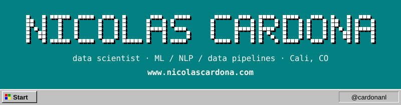
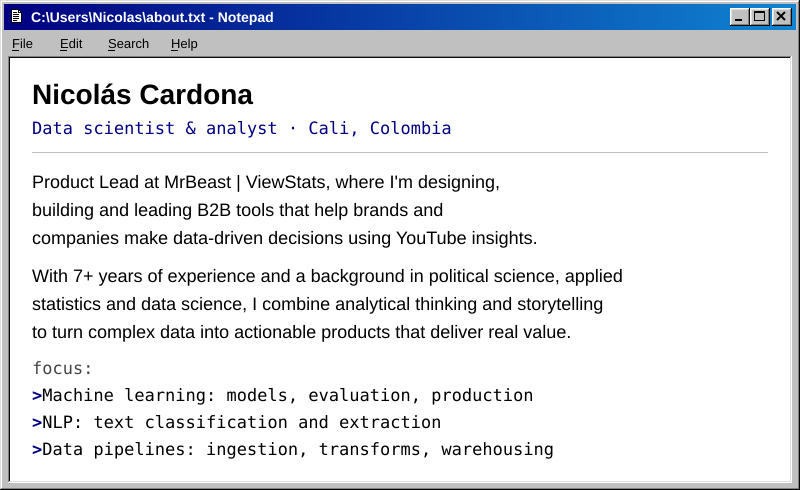
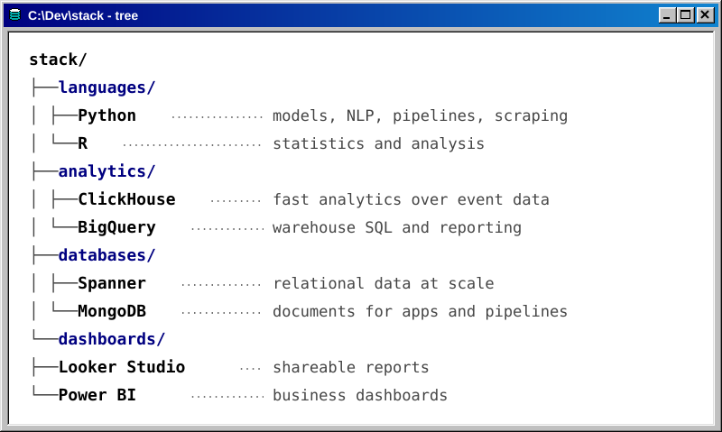
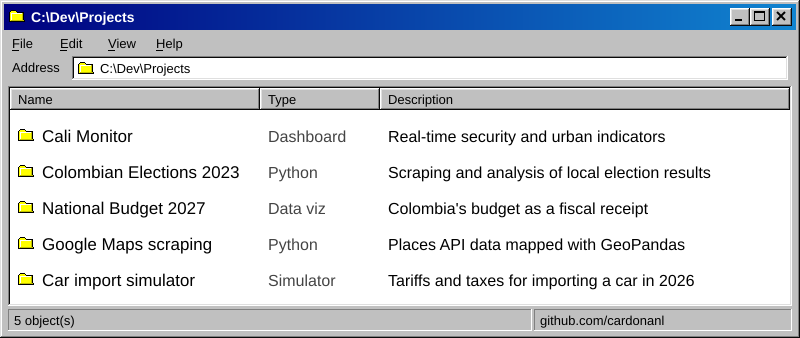

<!-- Generated by build.py from content.toml and palette.toml. Edit those, not this file. -->

<picture>
  <source media="(prefers-color-scheme: dark)" srcset="assets/banner-dark.svg">
  <source media="(prefers-color-scheme: light)" srcset="assets/banner-light.svg">
  
</picture>

<a href="https://nicolascardona.com">nicolascardona.com</a> · <a href="https://www.linkedin.com/in/nicol%C3%A1s-cardona-londo%C3%B1o-2a1321149/">LinkedIn</a> · <a href="https://x.com/cardonanl">X</a> · <a href="https://substack.com/@cardonanl">Substack</a>

<picture>
  <source media="(prefers-color-scheme: dark)" srcset="assets/terminal-dark.svg">
  <source media="(prefers-color-scheme: light)" srcset="assets/terminal-light.svg">
  
</picture>

<picture>
  <source media="(prefers-color-scheme: dark)" srcset="assets/about-dark.svg">
  <source media="(prefers-color-scheme: light)" srcset="assets/about-light.svg">
  
</picture>

<picture>
  <source media="(prefers-color-scheme: dark)" srcset="assets/stack-dark.svg">
  <source media="(prefers-color-scheme: light)" srcset="assets/stack-light.svg">
  
</picture>

<picture>
  <source media="(prefers-color-scheme: dark)" srcset="assets/projects-dark.svg">
  <source media="(prefers-color-scheme: light)" srcset="assets/projects-light.svg">
  
</picture>

<a href="https://calimonitor.nicolascardona.com/">Cali Monitor</a> · <a href="https://github.com/cardonanl/EleccionesLocalesColombia2023">Colombian Elections 2023</a> · <a href="https://presupuesto2027.nicolascardona.com/">National Budget 2027</a> · <a href="https://nicolascardona.com/single-post/mapeando-las-salchipaperias-en-cali-scrapping-aplicado">Google Maps scraping</a> · <a href="https://nicolascardona.com/importarcarro/">Car import simulator</a>

<a href="https://nicolascardona.com"><picture>
  <source media="(prefers-color-scheme: dark)" srcset="assets/icon-web-dark.svg">
  <source media="(prefers-color-scheme: light)" srcset="assets/icon-web-light.svg">
  
</picture></a>
<a href="https://www.linkedin.com/in/nicol%C3%A1s-cardona-londo%C3%B1o-2a1321149/"><picture>
  <source media="(prefers-color-scheme: dark)" srcset="assets/icon-linkedin-dark.svg">
  <source media="(prefers-color-scheme: light)" srcset="assets/icon-linkedin-light.svg">
  
</picture></a>

